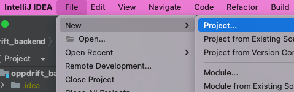
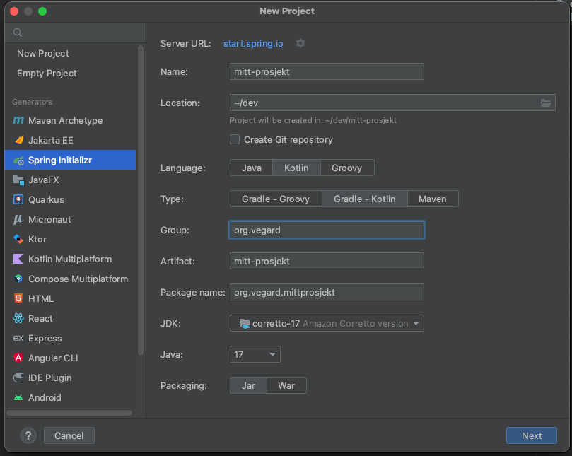
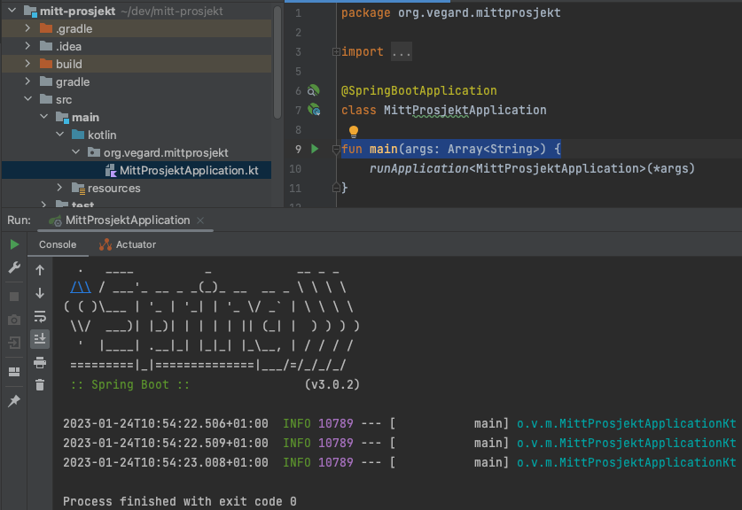

# Endepunkt


> [!NOTE]
> Hensikten med denne øvelsen er å bli kjent med IntelliJ og Spring Boot ved å lage en enkel web-løsning.
> Om du er kjent med IntelliJ og Spring Boot fra før, vil dette være veldig enkelt 😁.

Vi skal lage en løsning fra scratch! Vi kommer til å bruke **Spring Boot** sin wizard (Spring Initializr)
som man finner i Intellij for å opprette et Spring Boot prosjekt.

## Oppsett

Du trenger en JDK, versjon 21 eller nyere (Spring Boot 4 krever minst Java 17). IntelliJ kan laste ned en for deg
i prosjekt-wizarden under, eller du kan installere f.eks. [Temurin](https://adoptium.net/).

> [!NOTE]
> Spring Boot-wizarden er gratis i IntelliJ IDEA fra versjon 2025.3. Har du en eldre versjon uten wizarden, kan du gå til
> [start.spring.io](https://start.spring.io), velge de samme innstillingene som under, trykke *Generate*,
> pakke ut zip-fila og åpne mappa i IntelliJ.

Start med å opprette et nytt prosjekt ved å velge `File -> New -> Project..`



Deretter velg Spring Initializr. Her er det viktig at du velger:

```
Name: MittProsjekt
Language: Kotlin
Type: Gradle - Kotlin
JDK / Java: samme versjon som JDK-en du har installert (21 eller nyere)
Spring Boot: nyeste versjon som ikke er SNAPSHOT/RC/M (4.1.x i skrivende stund)
```

> [!IMPORTANT]
> Java-versjonen du velger havner i `build.gradle.kts` (`JavaLanguageVersion.of(...)`). Velger du en versjon du ikke har
> installert, feiler byggingen med `Cannot find a Java installation on your machine matching: {languageVersion=...}`.
> Da kan du enten installere den versjonen eller endre tallet i `build.gradle.kts`.

Kodeeksemplene under antar at hovedklassen heter `MittProsjektApplication`. Kaller du prosjektet noe annet, bytt ut navnet.

(Skjermbildene under er fra en eldre versjon av IntelliJ, så det kan se litt annerledes ut hos deg.)




Klikk igjennom steg-viseren. På neste steg kan man legge til forskjellige avhengigheter til Spring.
Vi kommer til å legge til de vi trenger manuelt senere. 

Det kan ta litt tid for Gradle å laste ned
alle pakkene, men når Intellij og Gradle er ferdige med å laste ned og bygge prosjektet ønsker vi
å kjøre opp løsningen. Det gjør vi ved å gå til Kotlin-fila i mappa `main/kotlin/<package name>` 
og trykker på den grønne pila.



Hvis du får ca samme output som det over så har vi en kjørende Spring Boot applikasjon. 
Den gjør ingenting enda, så la oss legge til litt greier.


## La oss legge til ting!

For at applikasjonen vår skal gjøre noe som helst må vi legge til noen avhengigheter.
Vi trenger to:

- `spring-boot-starter-webmvc` gir oss en webserver og muligheten til å definere REST-endepunkt.
- `jackson-module-kotlin` lar Spring gjøre om JSON til Kotlin-klasser (og tilbake).

For å legge til nye pakker/avhengigheter i prosjektet gå til `build.gradle.kts` og legg dem til
under dependencies:

```kotlin
dependencies {
    implementation("org.springframework.boot:spring-boot-starter")
    implementation("org.springframework.boot:spring-boot-starter-webmvc")
    implementation("tools.jackson.module:jackson-module-kotlin")
    ...
}
```

Trykk på Gradle-ikonet (elefanten) som dukker opp øverst til høyre i editoren for at IntelliJ skal laste ned de nye pakkene.

> [!TIP]
> Velger du *Spring Web* som avhengighet i wizarden, legges begge disse til automatisk.

## Endepunkt

Åpen Kotlin-fila som inneholder main metoden og lag et endepunkt! 
Dette gjør vi ved å legge til en klasse med en annotasjon:


```kotlin
import org.springframework.web.bind.annotation.GetMapping
import org.springframework.web.bind.annotation.RestController

...
fun main(args: Array<String>) {
    runApplication<MittProsjektApplication>(*args)
}

@RestController
class UserController {

    @GetMapping("user")
    fun user() = "Vegard"
}
```

Start applikasjonen på nytt (stopp den og trykk på den grønne pila igjen).
Standardporten til Spring Boot er 8080. Gå til http://localhost:8080/user for å nå endepunktet.


## Scheduler

Videre kan vi legge til en scheduler som kjører en jobb. Vi kan fortsette i samme Kotlin-fil,
eller lage en ny fil med koden under:

```kotlin
import org.springframework.context.annotation.Configuration
import org.springframework.scheduling.annotation.EnableScheduling
import org.springframework.scheduling.annotation.Scheduled

...
@Configuration
@EnableScheduling
class JobConfig {

    @Scheduled(fixedDelay = 2000, initialDelay = 500)
    fun letsGo() {
        println("Hei")
    }
}

```

Start applikasjonen på nytt og sjekk at "Hei" dukker opp i konsollen hvert andre sekund.

## Videre arbeid

### Send tilbake et objekt som JSON fra REST-endepunktet
I stedet for å returnere en `String` i endepunktet `user()` prøv å bruk en `data class` for å returnere JSON.

```kotlin
data class User(val name: String, val age: Int)
```


### Lag en HashMap "database" som holder på state

Lag et mutableMap som kan holde på state. 

```kotlin
val savedData: MutableMap<String, String> = mutableMapOf()
```

Bruk `savedData` for å lagre informasjon mellom kall mot et endepunkt. Noen forslag til hva som kan lages:

- En hitcounter
- En måte å lagre og hente meldinger på


<details>
  <summary>Eksempel på endepunkt med request param</summary>
  <p>

```kotlin
import org.springframework.web.bind.annotation.RequestParam

// http://localhost:8080/api/foo?id=hallo
@GetMapping("/api/foo")
fun getFoo(@RequestParam id: String) = "ID: $id"
```

  </p>
</details>


### Lage en state-machine som scheduleren oppdaterer underveis


Bruk kodeeksempelet for `@Scheduled`, kombiner det med en global state (f.eks MutableMap) og bruk en state-machine for å holde og endre på state.

<details>
  <summary>Eksempel kode for en enkel state-machine</summary>
  <p>


```kotlin
data class GameState(
    val isSeeingEnemy: Boolean = false,
    val isEnemyStrong: Boolean = false,
)

sealed class GhostState {

    data object Wander : GhostState()
    data object Chase : GhostState()
    data object Run : GhostState()

    fun nextState(state: GameState): GhostState =
        when (this) {
            Chase -> {
                if (state.isEnemyStrong && state.isSeeingEnemy) Run
                else if (!state.isSeeingEnemy) Wander
                else Chase
            }

            Run -> {
                if (!state.isEnemyStrong && state.isSeeingEnemy) Chase
                else if (!state.isSeeingEnemy) Wander
                else Run
            }

            Wander -> {
                if (state.isSeeingEnemy && state.isEnemyStrong) Run
                else if (state.isSeeingEnemy) Chase
                else Wander
            }
        }
}

// Eksempel på bruk, f.eks. fra scheduleren.
// (Ikke kall denne funksjonen main – da finner ikke Spring Boot ut hvilken main-metode som skal startes.)
fun ghostDemo() {
    val gameState = GameState(isSeeingEnemy = true, isEnemyStrong = true)
    val state = GhostState.Wander.nextState(gameState)
    println(state) // Run
}
```
</p>
</details>

### Bruk et eksternt API

Vi kan også kalle på eksterne API ved hjelp av Spring sin `RestClient`. Under er et kodeeksempel som henter ut
en pokemon fra [PokéAPI](https://pokeapi.co/) og tilgjengeliggjør den på `localhost:8080/poke/{pokemon}`,
f.eks. http://localhost:8080/poke/ditto.

```kotlin
import org.springframework.web.bind.annotation.GetMapping
import org.springframework.web.bind.annotation.PathVariable
import org.springframework.web.bind.annotation.RestController
import org.springframework.web.client.RestClient
import org.springframework.web.client.body

// PokéAPI returnerer mye mer enn dette. Felter vi ikke har definert blir ignorert.
data class Pokemon(val id: Int, val height: Int, val weight: Int)

@RestController
class PokemonController {
    private val restClient = RestClient.create("https://pokeapi.co/api/v2")

    @GetMapping("/poke/{name}")
    fun getPokemon(@PathVariable name: String): Pokemon? =
        restClient.get()
            .uri("/pokemon/{name}", name)
            .retrieve()
            .body<Pokemon>()
}
```

Prøv å utvide `Pokemon` med flere felter. Feltnavn med understrek i JSON (f.eks. `base_experience`) kan du
mappe med `@JsonProperty("base_experience") val baseExperience: Int`.
