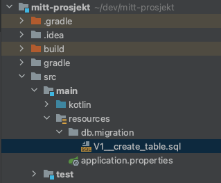

# Del 2 av løsning fra scratch 


> [!NOTE]
> I denne løsningen jobber vi videre med web-løsningen.
> Hensikten er å få en kjørende rest-applikasjon med database for lagring.

Ta utgangspunkt i det som ble gjort i [første del](../del_0/nytt-prosjekt.md) og jobb videre med samme kodebase.
Du kan også åpne den [her](./DatabaseIntegrasjon/backend), om du ikke fikk gjort oppgaven sist.


<details>
  <summary>Klikk for eksempelkode fra del 1</summary>
  <p>

```kotlin
package org.vegard.mittprosjekt

import org.springframework.boot.autoconfigure.SpringBootApplication
import org.springframework.boot.runApplication
import org.springframework.context.annotation.Configuration
import org.springframework.scheduling.annotation.EnableScheduling
import org.springframework.scheduling.annotation.Scheduled
import org.springframework.web.bind.annotation.GetMapping
import org.springframework.web.bind.annotation.RestController

@SpringBootApplication
class MittProsjektApplication

fun main(args: Array<String>) {
    runApplication<MittProsjektApplication>(*args)
}

@RestController
class UserController {

    @GetMapping("user")
    fun user() = "Vegard"
}

@Configuration
@EnableScheduling
class JobConfig {

    @Scheduled(fixedDelay = 2000, initialDelay = 500)
    fun letsGo() {
        println("Hei")
    }
}
```
  </p>
</details>


## Flyway og H2 oppsett

Database! Databaser! Data som lagres! Det er på tide å legge til en database i løsningen vår.

I dette eksemplet bruker vi H2, som er en in-memory database. Og Flyway som er et verktøy for
å holde styr på database migreringer. H2 er en in-memory database og
vil ikke lagre noe i mellom hver gang man kjører applikasjonen. Man har mulighet til å lagre
det som er i databasen til fil mellom hver kjøring, men mer om det senere. La oss legge til avhengighetene vi trenger
for H2 og Flyway.

I `build.gradle.kts` legg til avhengighetene for JDBC, Flyway og H2:

```kotlin
dependencies {
    implementation("org.springframework.boot:spring-boot-starter")
    implementation("org.springframework.boot:spring-boot-starter-webmvc")
    implementation("tools.jackson.module:jackson-module-kotlin")

    implementation("org.springframework.boot:spring-boot-starter-jdbc")
    implementation("org.springframework.boot:spring-boot-starter-flyway")
    runtimeOnly("com.h2database:h2")
    ...
}
```

> [!NOTE]
> Vi oppgir ikke versjonsnummer – Spring Boot velger versjoner som passer sammen.
> Merk at det må være `spring-boot-starter-flyway` og ikke bare `org.flywaydb:flyway-core`.
> Med bare `flyway-core` kjører ikke migrasjonene i Spring Boot 4, og du får ingen feilmelding før du prøver å bruke tabellene.

Etter vi har lagt til pakkene må vi også definere hvordan Spring skal bruke databasen.
Spring Boot kommer med en hel del magi ut av boksen, så alt vi trenger å gjøre
for å få Spring til å snakke med databasen er å definere følgende i `src/main/resources/application.properties`:


```properties
spring.datasource.url=jdbc:h2:mem:testdb
spring.datasource.username=sa
spring.datasource.password=
```

Flyway sine migrasjonfiler har et spesifikt format som sier noe om rekkefølgen 
([les mer om det her](https://documentation.red-gate.com/fd/migrations-271585107.html)).

Migrasjonsfilene må ligge under `src/main/resources/db/migration/<navn>.sql` for at Spring skal plukke de opp
automatisk.



Da gjenstår det bare å opprette en database med noe data. Under er to eksempel-filer:

```sql
-- V1__create_table.sql
CREATE TABLE Users (
    id INT PRIMARY KEY,
    title VARCHAR(50),
    username VARCHAR(50)
);
```

```sql
-- V2__insert_users.sql
INSERT INTO Users (id, title, username) VALUES (1, 'Konsulent', 'Vegard');
INSERT INTO Users (id, title, username) VALUES (2, 'Artist', 'Donny Benet');
```

## Bruk av database i Spring boot

Etter vi har lagt til Flyway og H2 er det nå på tide å bruke databasen i løsningen vår.
I endepunktet fra del 1, legg til `DataSource` og bruk denne i endepunktet.
Eksempel-kode under:


```kotlin
import javax.sql.DataSource

@RestController
class UserController(val dataSource: DataSource) {

    @GetMapping("user")
    fun user(): List<String> {
        val users = dataSource.connection.use { connection ->
            val sql = "SELECT * FROM Users"
            val resultSet = connection.createStatement().executeQuery(sql)
            val usernames = mutableListOf<String>()
            while (resultSet.next()) {
                usernames.add(resultSet.getString("username"))
            }
            usernames
        }
        return users
    }
}
```

Start applikasjonen på nytt og gå til http://localhost:8080/user. Du skal få `["Vegard","Donny Benet"]`.
I konsollen kan du se at Flyway har kjørt migrasjonene (`Successfully applied 2 migrations`).

> [!NOTE]
> Du vil kanskje se en advarsel om at H2-versjonen er nyere enn det Flyway er verifisert med. Den kan du trygt ignorere.

## Lagring av data mellom hver kjøring

H2 kommer med mulighet for å lagre databasen mellom hver kjøring ved å definere en fil.

Bytt ut `spring.datasource.url`-linjen i `src/main/resources/application.properties` med følgende for å lagre H2-databasen til fil:

```properties
spring.datasource.url=jdbc:h2:file:./testdb
```

Databasen lagres nå i fila `testdb.mv.db` i prosjektmappa. Vil du starte med en tom database igjen
(med bare testdataene fra migrasjonene), stopp applikasjonen og slett fila.


## Videre arbeid

Fortsett med oppgavene fra [del 1 - nytt prosjekt](../del_0/nytt-prosjekt.md) og bruk det du har lært om databaser.
